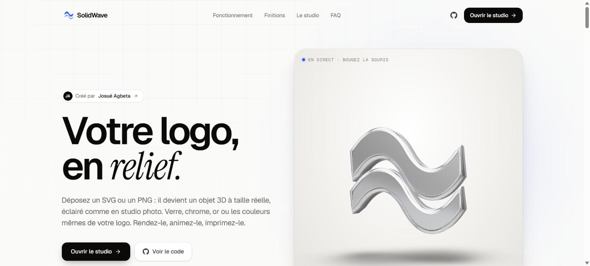
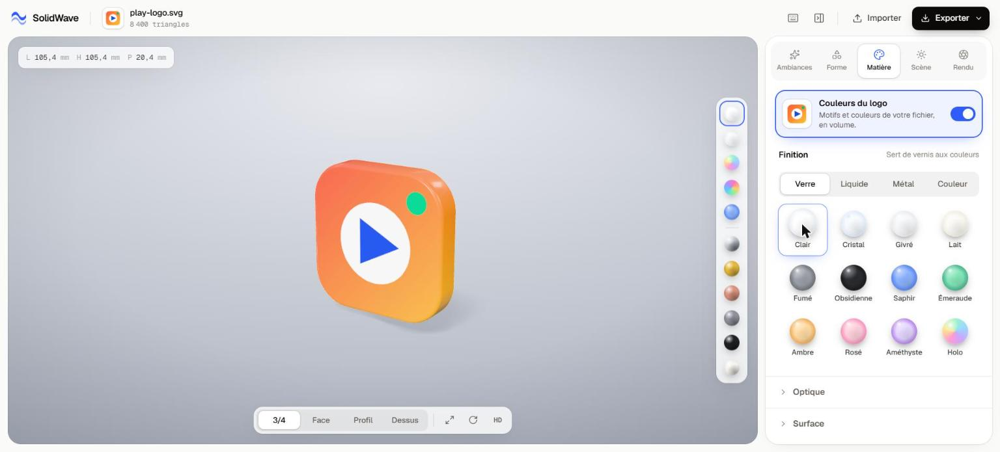
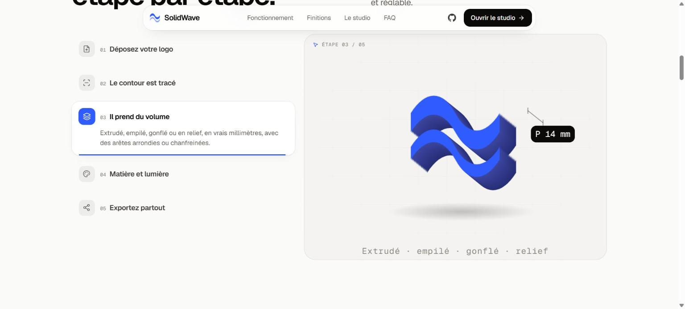

<div align="center">

# SolidWave

**Votre logo, en relief.**

Transformez n’importe quel logo SVG ou PNG en objet 3D à taille réelle, éclairé comme en studio photo,
puis exportez-le en image 4K, en vidéo 360° ou en modèle 3D. Directement dans le navigateur, sans compte,
sans rien envoyer.

Créé par [Josué Agbeta](https://josue-agbeta.vercel.app/)




</div>

## Pourquoi SolidWave

Donner du volume à un logo demande d’habitude un logiciel 3D, du temps et un savoir-faire de modélisation,
d’éclairage et de rendu. SolidWave fait tout ce chemin en quelques secondes : vous déposez un fichier, vous
choisissez une matière, et vous obtenez un rendu digne d’un packshot de studio.

Tout tourne sur votre machine. La vectorisation, la géométrie et le rendu utilisent votre carte graphique
via WebGL : vos fichiers ne quittent jamais votre navigateur.

## Fonctionnalités

- **Import universel** : SVG lus tels quels, PNG, JPG et WebP vectorisés automatiquement (détection par
  contraste, transparence ou couleur, lissage, trous et détails fins conservés).
- **Quatre volumes** : extrudé, empilé, gonflé ou en relief, en vrais millimètres, avec des arêtes arrondies
  ou chanfreinées.
- **29 finitions physiquement réalistes** : verres (clair, givré, holographique, prismatique…), métaux (chrome,
  or, titane, cuivre…), couleurs et liquides, avec réfraction, dispersion et irisation.
- **Couleurs du logo** : le dessin de votre fichier, dégradés et détails compris, est reproduit sur l’objet,
  et chaque tranche prend la couleur du bord.
- **Éclairage de studio** : pièce de studio procédurale, boîtes à lumière et bandes lumineuses orientables,
  ombres douces accumulées ou sol miroir.
- **Ambiances en un clic** : finition, lumière, fond, sol et effets réglés ensemble, puis entièrement
  modifiables.
- **Exports**
  - PNG jusqu’en 4096 px, fond transparent ou intégré ;
  - vidéo 360° en MP4, 60 images/s, en 1:1, 9:16 ou 16:9, qui boucle sans coupure ;
  - GLB (glTF binaire) pour le web, three.js, Spline, Blender ou la réalité augmentée ;
  - STL fermé, en millimètres, prêt pour l’impression 3D.



## Comment ça marche

1. **Import** : le fichier est lu dans le navigateur.
2. **Tracé** : les tracés SVG sont convertis en formes ; les images passent par un champ scalaire, un flou,
   l’algorithme des *marching squares*, puis une simplification et un lissage des contours.
3. **Volume** : les formes sont extrudées avec un biseau et des normales pliées, pour des arêtes douces et
   des faces parfaitement planes.
4. **Matière et lumière** : matériaux physiques de three.js éclairés par un environnement de studio, avec
   tone mapping, ombres et post-traitement.
5. **Export** : rendu hors écran pour les PNG, encodage image par image (WebCodecs) pour la vidéo,
   exporteurs GLB et STL pour la 3D.



## Démarrer en local

Prérequis : Node.js 20 ou plus récent.

```bash
git clone https://github.com/Josueagbeta0/solidwave.git
cd solidwave
npm install
npm run dev
```

Ouvrez ensuite http://localhost:3000 (la page d’accueil) ou http://localhost:3000/studio (le studio).

| Commande | Rôle |
| --- | --- |
| `npm run dev` | Serveur de développement |
| `npm run build` | Build de production (vérifie aussi les types) |
| `npm run start` | Sert le build de production |
| `npm run lint` | ESLint |
| `npm run typecheck` | Vérification TypeScript |

Le studio accepte aussi des paramètres d’URL : `/studio?sample=bolt&finish=gold&quality=ultra`.

## Stack technique

- **Next.js 16** (App Router) et **React 19**
- **three.js**, **React Three Fiber** et **drei** pour la scène, **postprocessing** pour le rendu final
- **Tailwind CSS 4** pour l’interface, **Lenis** pour le défilement doux de la page d’accueil
- **WebCodecs** et **mp4-muxer** pour l’export vidéo
- **TypeScript** de bout en bout

## Structure du projet

```
app/                    Routes : page d’accueil (/) et studio (/studio)
components/landing/     Sections de la page d’accueil
components/studio/      Studio : interface, canevas 3D, contrôles
lib/trace.ts            Vectorisation des images et lecture des SVG
lib/studio/             Géométrie, matières, éclairages, ambiances, textures
docs/                   Captures d’écran du README
```

Le fonctionnement interne (pipeline, rendu à la demande, pièges connus) est détaillé dans
[CLAUDE.md](CLAUDE.md).

## Confidentialité

Aucun serveur, aucun compte, aucun suivi. Les fichiers importés restent dans l’onglet du navigateur et
disparaissent quand vous le fermez.

## Auteur

Conçu et développé par **Josué Agbeta** :
[portfolio](https://josue-agbeta.vercel.app/) · [GitHub](https://github.com/Josueagbeta0)

## Licence

Distribué sous licence [MIT](LICENSE). Vous pouvez lire, modifier et réutiliser le code librement, en
conservant la mention de copyright.
